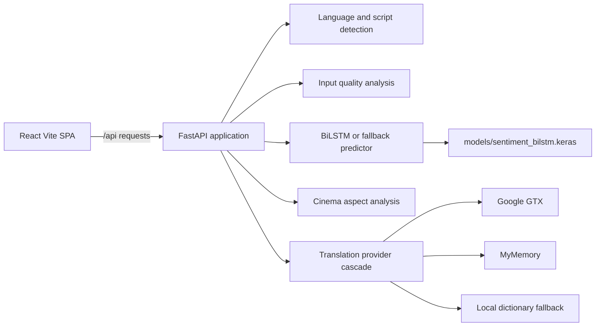

# MuVora: Multilingual Cinema Review Intelligence & Translation Platform

<div align="center">


**An intelligent, production-quality multilingual cinema review intelligence platform featuring Bidirectional LSTM neural classification, dynamic cinema aspect sentiment analysis, and Google-Translate-style multilingual translation with voice input and audio pronunciation.**

</div>

---
# MuVora

MuVora is a React and FastAPI application for multilingual movie-review analysis and translation.

It detects writing scripts and transliterated Indic-language input, evaluates review sentiment and quality, extracts cinema-related aspects, and provides translation workflows. The repository includes a trained BiLSTM model, a rule-based fallback predictor, browser speech input/output, and automated backend tests.

Live demo: not currently configured.

## Contents

- [Features](#features)
- [Architecture](#architecture)
- [Repository Structure](#repository-structure)
- [Technology](#technology)
- [Local Setup](#local-setup)
- [Configuration](#configuration)
- [API](#api)
- [Render Deployment](#render-deployment)
- [Testing](#testing)
- [Troubleshooting](#troubleshooting)
- [Limitations](#limitations)
- [Contributing](#contributing)
- [License](#license)

## Features

### Review analysis

- Positive, negative, or uncertain sentiment classification.
- Positive and negative probabilities with confidence values.
- Review-quality checks for empty, repetitive, random, and out-of-domain input.
- Aspect analysis for acting, story, direction, screenplay, music, visuals, and overall experience.
- Evidence phrases and narrative synthesis in the API response.
- Native-script detection for Telugu, Hindi, Tamil, Kannada, Malayalam, Bengali, Marathi, Gujarati, Punjabi, Urdu, and Odia.
- Romanized Telugu and Hindi pattern detection.
- Code-mixed language and script detection.

### Translation

- Automatic source-language detection or an explicit source-language hint.
- Multiple target languages in one request.
- Google GTX, MyMemory, `deep-translator`, and local dictionary fallback providers.
- Romanized Telugu and Hindi normalization for recognized phrases.

### Frontend experience

- React single-page interface with analyzer, translator, history, insights, and about views.
- Browser local storage for analysis history.
- Optional Web Speech API dictation and text-to-speech pronunciation.
- Responsive UI with a frontend error boundary.

## Architecture



The frontend is a static Vite build. The backend is a long-running FastAPI service. For Render, deploy them as separate services: a Static Site for the frontend and a Docker Web Service for the backend. The checked-in `render.yaml` describes both services.

The backend does not use a database or authentication system. Browser history is stored locally in the user's browser. Translation providers are external network dependencies and may be rate-limited.

## Repository Structure

| Path | Purpose |
| --- | --- |
| `backend/app/api` | FastAPI route handlers |
| `backend/app/core` | Configuration and logging |
| `backend/app/schemas` | Pydantic request and response models |
| `backend/app/services` | Sentiment, quality, language, aspect, and translation services |
| `backend/ml` | Model prediction, preprocessing, metrics, and training code |
| `backend/tests` | Backend API and service tests |
| `frontend/src/components` | React views and reusable UI components |
| `frontend/src/hooks` | React hooks, including browser history management |
| `frontend/src/services` | Frontend API client |
| `frontend/src/types` | Shared TypeScript response and request types |
| `models` | Model weights, vocabulary, metadata, and sample history data |
| `.github/workflows` | GitHub Actions CI configuration |
| `render.yaml` | Render Blueprint for frontend and backend services |
| `docker-compose.yml` | Local Docker orchestration |

## Technology

| Layer | Technology | Evidence in repository |
| --- | --- | --- |
| Frontend | React 18, TypeScript, Vite | `frontend/package.json` |
| Styling | TailwindCSS, Framer Motion, Lucide React | `frontend/package.json` and `frontend/src` |
| Backend | FastAPI, Uvicorn, Pydantic | `backend/requirements.txt` and `backend/app` |
| ML | TensorFlow/Keras, NumPy, scikit-learn | `backend/requirements.txt` and `backend/ml` |
| Language detection | `langdetect` plus custom Unicode and transliteration logic | `backend/app/services` |
| Translation | `deep-translator` plus direct HTTP providers and local fallback | `backend/app/services/translation_service.py` |
| Deployment | Docker, Render Blueprint, optional Vercel frontend config | `backend/Dockerfile`, `render.yaml`, `vercel.json` |

The model metadata records an evaluation accuracy of `0.865`, precision of `0.8977`, recall of `0.8238`, F1 of `0.8592`, and ROC AUC of `0.944`. These are recorded model evaluation metrics, not a guarantee for every language, domain, or review.

## Local Setup

### Prerequisites

- Git
- Node.js 18 or newer
- Python 3.11
- Optional: Docker Desktop

Python dependencies are listed in [backend/requirements.txt](backend/requirements.txt). Frontend dependencies are locked in [frontend/package-lock.json](frontend/package-lock.json).

### Backend

From the repository root, create or activate a Python 3.11 environment and install dependencies:

```powershell
D:\anaconda\envs\muvora\python.exe -m pip install -r backend\requirements.txt
```

Use the Python executable for your environment if it is different. Start the API:

```powershell
D:\anaconda\envs\muvora\Scripts\uvicorn.exe backend.app.main:app --host 127.0.0.1 --port 8000 --reload
```

The API is available at [http://127.0.0.1:8000](http://127.0.0.1:8000). Interactive documentation is at [http://127.0.0.1:8000/docs](http://127.0.0.1:8000/docs).

### Frontend

In a second terminal:

```powershell
cd frontend
npm ci
npm run dev
```

Open [http://127.0.0.1:5173](http://127.0.0.1:5173). With no `VITE_API_BASE_URL`, Vite proxies `/api` requests to the local backend at port 8000.

### Docker Compose

Docker Compose is configured to build the backend from the repository root so the `backend` Python package and `models` directory are available in the image:

```powershell
docker compose up --build
```

The Docker frontend is served at [http://127.0.0.1:3000](http://127.0.0.1:3000), and the backend is served at [http://127.0.0.1:8000](http://127.0.0.1:8000).

## Configuration

Copy the examples as appropriate for local work. Do not commit `.env` files or secret values.

### Backend variables

| Variable | Required | Purpose |
| --- | --- | --- |
| `PROJECT_NAME` | No | API display name; defaults to `MuVora` |
| `DEBUG` | No | Debug setting; defaults to `False` |
| `CORS_ORIGINS` | No | Allowed frontend origins |
| `MODEL_PATH` | No | Keras model path |
| `VOCAB_PATH` | No | Vocabulary JSON path |
| `METADATA_PATH` | No | Model metadata path |
| `VOCAB_SIZE` | No | Predictor vocabulary size |
| `MAX_SEQUENCE_LENGTH` | No | Predictor sequence length |
| `EMBEDDING_DIM` | No | Model embedding dimension |
| `MAX_REVIEW_LENGTH` | No | Maximum review length |
| `MAX_BATCH_SIZE` | No | Maximum batch request size |
| `TRANSLATION_TIMEOUT_SECONDS` | No | External translation timeout |
| `MOCK_TRANSLATION` | No | Use the local dictionary provider when `True` |

The repository's root [.env.example](.env.example) contains backend defaults. The frontend [frontend/.env.example](frontend/.env.example) contains the browser-safe `VITE_API_BASE_URL` variable.

### Frontend variable

| Variable | Required | Purpose |
| --- | --- | --- |
| `VITE_API_BASE_URL` | No | Backend origin or API URL. If an origin is supplied, `/api` is appended automatically. |

Never put backend secrets in `VITE_*` variables because Vite embeds them into the browser bundle.

## API

All application routes are under `/api`.

| Method | Route | Purpose |
| --- | --- | --- |
| `GET` | `/api/health` | Backend and model health |
| `GET` | `/api/model-info` | Model metadata and supported languages |
| `GET` | `/api/supported-languages` | Translation language registry |
| `POST` | `/api/analyze` | Analyze one movie review |
| `POST` | `/api/analyze/batch` | Analyze up to 20 reviews |
| `POST` | `/api/detect-language` | Detect language, script, transliteration, and code mixing |
| `POST` | `/api/translate` | Translate into one or more target languages |
| `POST` | `/api/feedback` | Submit analysis feedback |

### Analyze a review

```bash
curl -X POST http://127.0.0.1:8000/api/analyze \
  -H "Content-Type: application/json" \
  -d '{
    "movie_title": "Interstellar",
    "review": "I loved this movie. The acting was excellent and the story was emotional.",
    "language_hint": "auto",
    "include_translation": true,
    "analysis_language": "en",
    "analysis_depth": "detailed"
  }'
```

The response includes the request ID, detected language, quality status, sentiment, probabilities, confidence, model backend, language details, aspects, key phrases, and narrative synthesis.

### Translate text

```bash
curl -X POST http://127.0.0.1:8000/api/translate \
  -H "Content-Type: application/json" \
  -d '{
    "text": "The movie is awesome",
    "source_language": "en",
    "target_languages": ["te", "hi"]
  }'
```

Validation errors are returned by FastAPI as HTTP 422 responses. Empty translation text returns HTTP 400. Unexpected analysis errors return a safe HTTP 500 response and are logged server-side.

## Render Deployment

The checked-in [render.yaml](render.yaml) defines two services:

| Service | Render type | Configuration |
| --- | --- | --- |
| `muvora-api` | Docker Web Service | Dockerfile: `backend/Dockerfile`, context: repository root, health check: `/api/health` |
| `muvora-frontend` | Static Site | Root: `frontend`, build: `npm ci && npm run build`, publish directory: `dist` |

### Deploy with a Blueprint

1. Push this branch to the target GitHub repository.
2. In Render, select **New**, then **Blueprint**.
3. Connect `SatishReddy2804/MuVora-Multilingual-Film-Sentiment-Intelligence-`.
4. Select the branch containing `render.yaml`.
5. Review the two services and create the Blueprint.
6. Wait for the backend health check to pass.
7. Confirm the static site build receives `VITE_API_BASE_URL` from the backend service.

The backend Docker command listens on Render's `PORT` environment variable and falls back to port 8000 locally. The frontend API client accepts either a complete API URL or a backend host and normalizes the `/api` path.

### Render environment variables

The Blueprint supplies non-secret backend paths and defaults. Review these values in the Render dashboard, especially:

- `MODEL_PATH=/app/models/sentiment_bilstm.keras`
- `VOCAB_PATH=/app/models/vocab.json`
- `METADATA_PATH=/app/models/metadata.json`
- `CORS_ORIGINS`
- `VITE_API_BASE_URL` on the static site

No provider secret is required by the current translation implementation. External translation services can still impose quotas and network restrictions. Render deployment itself has not been executed from this workspace.

### Deployment checks

- Open the frontend URL.
- Confirm `/api/health` returns `status: "ok"` on the backend URL.
- Submit an English review.
- Test Telugu, Hindi, Romanized, and code-mixed input.
- Test translation provider fallback behavior.
- Refresh the frontend at a client-side route if one is added later.
- Review Render logs for model loading and translation failures.

## Testing

Run the available checks from the repository root:

```powershell
cd frontend
npm run typecheck
npm run build
cd ..
D:\anaconda\envs\muvora\python.exe -m pytest backend/tests -v
```

The backend suite contains 31 tests covering health and model information, positive and negative analysis, quality checks, native Telugu and Hindi, Romanized input, code mixing, language detection, translation, aspect evidence, preprocessing, and metrics.

There is currently no frontend lint script, no browser automation suite, and no automated Render smoke test.

## Troubleshooting

### Frontend shows API errors

Start the backend on port 8000, or set `VITE_API_BASE_URL` to the deployed backend origin before building the frontend.

### Backend does not start

Confirm Python 3.11 and the dependencies in `backend/requirements.txt` are installed. TensorFlow model loading can take time and requires additional memory. If the trained model cannot load, the predictor activates its development fallback and reports that backend in model metadata.

### Translation fails

External providers may be rate-limited or unavailable. The service attempts multiple providers and then uses the local dictionary fallback. The fallback is intentionally limited and does not provide general machine translation.

### Microphone or audio controls do not work

The browser must support the Web Speech API, and microphone access must be granted. Text analysis and translation do not require microphone access.

## Limitations

- Model evaluation metrics come from the stored metadata and do not establish accuracy for every language or movie-review domain.
- Translation quality depends on external providers and the limited local dictionary fallback.
- Romanized-language normalization recognizes configured patterns rather than all possible spellings.
- Sarcasm, slang, mixed opinions, and culturally specific language may be misclassified.
- Browser speech features depend on browser support and permissions.
- The backend has no authentication or rate limiting configured.
- Render deployment and production provider quotas still require maintainer verification.

## Contributing

1. Create a feature branch from the current default branch.
2. Keep changes focused and preserve Unicode input support.
3. Do not commit `.env` files, secrets, generated builds, or local caches.
4. Run the frontend typecheck/build and backend tests.
5. Use a conventional commit prefix such as `feat:`, `fix:`, `test:`, `docs:`, or `chore:`.
6. Open a pull request describing the behavior change and validation results.

## License

No license file or explicit license declaration is currently included in this repository. Add a license before distributing the project under specific terms.

## Acknowledgements

The project uses React, Vite, TailwindCSS, FastAPI, Uvicorn, Pydantic, TensorFlow, Keras, NumPy, scikit-learn, langdetect, deep-translator, Google GTX, and MyMemory. The stored model metadata identifies an IMDB-trained sentiment model; verify dataset licensing and attribution requirements before redistribution.

## Support

Issue tracking, discussions, and a live demo are not currently documented in this repository. Use the GitHub repository's issue tracker after the target repository is populated.
